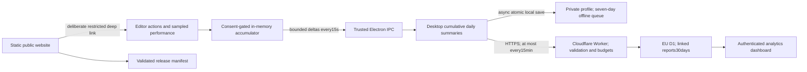

# StykAnimate profiling and analytics

The desktop collector, Cloudflare service and private dashboard use one versioned allowlist: `src/telemetry-schema.mjs`. There are no third-party analytics SDKs, session replay, advertising identifiers or paid analytics subscriptions.

## Architecture



`src/telemetry-core.mjs` counts and aggregates in constant, bounded memory. It creates no extra animation loop. CPU submission timings are sampled once per30 rendered frames. A15-second activity sampler runs only with consent; it records an activity timestamp, never a key or pointer value. PerformanceObserver collects long tasks and slow input events only with diagnostics consent. It does not retain event targets or text.

`desktop/telemetry.cjs` owns the private random32-byte installation token, hashes it for report identity, revalidates IPC and merges deltas. It saves locally outside the render path, batches uploads, respects Retry-After, aborts pending uploads on withdrawal, keeps at most seven days of unsent summaries, and retries requested deletion. Disabled reporting has no sampling, upload or persistence timer. An acknowledged baseline for today prevents a same-day opt-out/re-opt-in from reducing previously accepted totals. Local first-observed milestones survive a longer absence.

`cloud/worker.mjs` enforces the same schema, derives identity from the bearer token, stores one cumulative installation/day snapshot with a monotonic sequence, and makes retries idempotent. The database never stores the private token. It rejects arbitrary fields, oversized JSON, invalid dates/metrics and deleted identities. A30-day hash-only deletion marker prevents delayed uploads from recreating erased reports. See `docs/analytics-service.md` for database budgets, authentication, retention and operational setup.

The public website, configuration and release manifest are static assets: normal visits execute no Worker code and access no D1 data. Only telemetry, feedback and administrator routes run Worker-first; unknown API routes return a Worker 404. Public pages contain no tracking code or third-party font requests. The dashboard uses a private server session in an HttpOnly cookie, same-origin mutation checks, login rate limits and no credentials in its client JavaScript. Secrets must never be placed in `desktop/service-config.json` or public assets.

Unchanged reports are not uploaded. Idle-only changes wait for the next useful report, and leaving the app idle across midnight does not create an idle-only installation-day. Resource sampling runs only while the app is foregrounded. Memory, file persistence and networking stay outside the renderer's frame path. A deliberate manual sync can upload deferred data immediately.

## Collection and metric interpretation

All currently supported counters, timings, maxima and dimensions are visible in the dashboard. A missing diagnostic is missing data, not a measured zero. Daily installation summaries identify installations, not people; opt-out users cannot be counted.

| Category | What it measures | Important interpretation |
| --- | --- | --- |
| Product | Sessions observed, active/idle seconds, timeline-mode seconds, edit notifications, first observed launch/edit/save/export dates | Active means focused and foreground with input in the last60seconds or playback running; short intervals and sleep are clamped. Idle-only reports are deferred. First launch means first launch observed after consent. |
| Features | Open/new, undo/redo, clipboard, duplicate/delete, keyframe, onion, camera, builder, IK controls, library and movieclip commands | Counts instrumented command attempts or committed edit notifications, not every mouse gesture. Cancelled edits can emit edit notifications. Never infer unique documents from these counters. |
| File operations | Start/success/failure/cancellation, broad import/export format families | A command’s format counter is an attempt; use successful operation totals to judge completion. Import batches count as one operation. |
| Timings | Startup, imports/decoder, serialization, exports, recovery, frame submissions, slow input, long tasks, playback startup/intervals/buffering | Save/recovery/native-export timing measures serialization; render export timing ends before the save dialog. Import includes any confirmation delay. Frame timing is CPU submission time, not measured GPU execution. |
| Playback | Starts, elapsed playback seconds, presented frames, buffering events/time, bounded recent interval samples | These are sampled summaries. Intervals cover at most the last300presentations per stopped playback; forced exits may lose the last incomplete playback. No claim of exact displayed FPS. |
| Resources | Once-per-minute aggregate Electron CPU and working set; sampled JS heap and renderer GPU allocation/draw/upload/object/primitive peaks | Peaks are maxima of samples, not continuous maxima. GPU allocation is the renderer’s tracked allocation, not total GPU memory. Electron process totals exclude the Python sidecar. |
| Compatibility | App release/channel, broad OS/version/architecture, RAM/CPU buckets, coarse GPU vendor, rendering availability, language and latest timeline mode | No exact device model, hardware serial, display resolution or location. Mixed release/mode days belong to the latest snapshot; mode filters select whole days with observed mode use. |
| Reliability | Caught/unhandled JavaScript errors, renderer exits/hangs, backend errors, GPU loss, prior unclean termination | Only allowlisted error type, operation, source module/line and hash; no raw messages, arguments or paths. An unclean exit may be a power loss or forced quit. No automatic full native crash dumps. |
| Feedback | Category, explicitly submitted message, release and platform, deletion identity | Separate from profiling consent; sent only by the form action. No automatic attachment. Contact is the published support email. |

Histograms use fixed upper bounds from1ms to one hour. p50/p95 are approximate bucket upper bounds capped by observed maximum. Out-of-range values are dropped. Error groups are capped at20per local day and are deduplicated when the same Error reaches multiple handlers. Network failure does not interrupt editing; the last15seconds of renderer deltas or60seconds of unpersisted main-process data may be lost on a sudden crash.

Activation and repeat-creation metrics disclose their eligible populations and observation windows in the dashboard. Today is incomplete. Offline delivery, consent, deletion, rate limits, seven-day local expiry and30-day server retention bias estimates. Do not present participation metrics as the total audience or a crash-free-session percentage.

## Privacy UX

First run shows a compact Accept/Reject prompt. Accept explicitly enables both optional categories; Reject leaves both off. Expanded details offer independent choices and the full notice. Closing the prompt leaves collection off. Controls are available in Preferences → Privacy & diagnostics and Help → Privacy & diagnostics.

Reports exclude animation contents, document and asset names, paths, text, clipboard contents, keys, pointer coordinates, screenshots, recordings and raw exception messages. The publisher name is StykAnimate; contact is ale.ripreso@gmail.com, as requested. Linked reports are retained30days, feedback90days, and thresholded identifier-free daily statistics up to365days. The local private deletion token authenticates requests and is excluded from JSON previews/exports. Withdrawal stops future collection; deletion also erases retained linked data and rotates the identity. The notice distinguishes hosting-provider network processing from application analytics storage.

This implements technical consent and data controls. Whether a trade name alone sufficiently identifies the controller, age-related requirements, and the publisher’s specific legal obligations depend on how the beta is offered; code cannot certify legal compliance. Relevant references: [EDPB consent guidance](https://www.edpb.europa.eu/documents/guideline/guidelines-052020-on-consent-under-regulation-2016679_en), [Cloudflare DPA](https://www.cloudflare.com/cloudflare-customer-dpa/), [Cloudflare privacy policy](https://www.cloudflare.com/privacypolicy/).

## Detailed local profiling

Preferences → Privacy & diagnostics → details → performance trace records30seconds of bounded Chromium timeline/V8 profiling data. The privacy modal closes so the user can reproduce the issue; a small non-modal recording indicator remains. The user chooses whether and where to save the trace. Nothing uploads automatically. Traces can contain URLs and local paths, so the UI instructs users to inspect them before sharing. Temporary recording overhead is expected. Open the saved JSON in Chrome tracing or Perfetto. This is not continuous profiling or a Python/native process profiler.

## Website and release integration

`desktop/service-config.json` contains only the public site origin, publisher/contact and release channel. A development run can use `STYK_SITE_URL=http://127.0.0.1:PORT`; production accepts HTTPS only. Main process networking avoids broadening renderer privileges or exposing tokens. `stykanimate://open` opens/focuses the installed application; `stykanimate://privacy` opens its privacy panel. All other routes, parameters, paths and credentials are rejected. The protocol never opens downloaded files or executes commands.

The download page reads the validated release manifest. Publish a current, tested installer/portable artifact on a suitable download host and supply HTTPS URL, version, size and SHA-256 in `LATEST_RELEASE_JSON`. Then regenerate and deploy the public API assets together with the Worker. Until a release is configured, the download page honestly shows that the beta is not yet published. Existing Windows installers are larger than Cloudflare’s25MiB static-asset limit; they must use a separate release/download host.

The production origin is https://stykanimate.com, with www.stykanimate.com bound to the same Worker. The private dashboard is /admin/. Its initial login key is in the ignored local file `artifacts/stykanimate-admin-key.txt`; it is never bundled into the app or public assets. `scripts/verify-cloudflare-live.mjs` checks HTTPS pages, security headers, static public API delivery and authenticated production D1 reads without submitting synthetic telemetry.

## Verification

Commands from the repository root:

```text
node --test tests/telemetry.test.mjs
node scripts/benchmark-telemetry.mjs
node scripts/benchmark-telemetry-desktop.mjs
node scripts/smoke-telemetry.mjs
node --test cloud/tests/*.test.mjs
node cloud/tests/runtime.mjs
node cloud/tests/dashboard.browser.mjs
node scripts/check.mjs
```

The Electron smoke test uses an isolated profile and local Worker routes backed by real SQLite. It exercises no-consent behavior, acceptance, actual edit/playback/native-save summaries, error redaction, administrator login and dashboard rendering, explicit feedback, Chromium trace capture/discard, deletion and rejected late replay. Synthetic fixtures stay local. Windows may require normal process access for Chromium’s GPU subprocess; the sandbox’s missing-DLL termination is not an application crash regression.

Evidence lives under ignored `artifacts/telemetry/`, `artifacts/privacy-ui/`, `artifacts/public-site/` and `artifacts/telemetry-performance.json`. The collector microbenchmark isolates counter/histogram work; it does not establish a universal end-to-end performance percentage.

The 2026-09-10 native-GPU Electron comparison used 1,000 figures, 24 animation keys and four disabled/enabled/enabled/disabled rounds. Each sustained approximately 60 FPS with renderer CPU p95 of 0.30 ms. Enabled summary IPC measured 0.7–1.3 ms of asynchronous wall time. No practical playback slowdown was observed in that bounded test. It does not establish performance across all hardware, documents or packaged builds; full measurements and limitations are in `artifacts/telemetry/desktop-performance-summary.md`.
